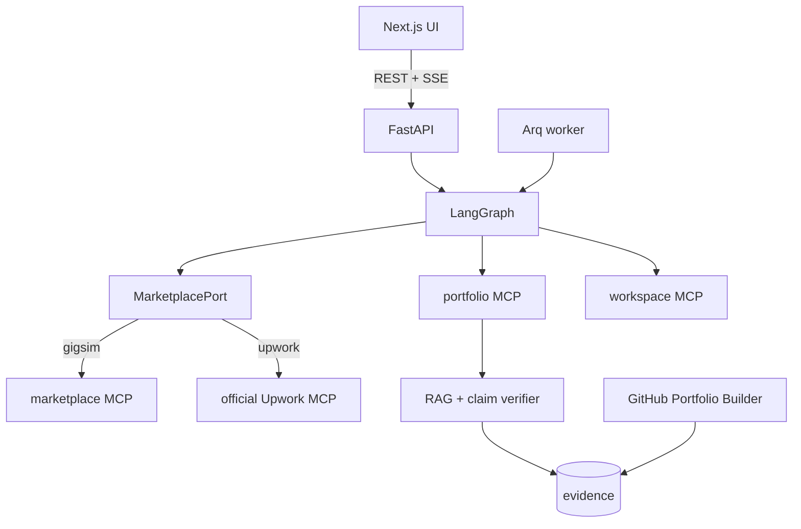
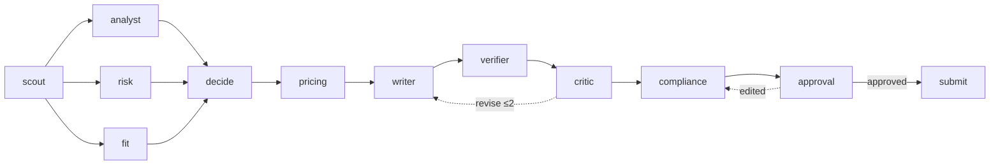

# GigBid — AI-4016 Freelancer Copilot

   

GigBid reads freelance job posts, rejects scams and injected instructions, matches the job to **verified** evidence from your portfolio, drafts a proposal in your voice, checks every claim against that evidence, and then waits for **you** to approve. Nothing is sent without a human approving it and confirming it on the platform.

**Live link:** `http://localhost:3000 (run locally — see Quick Start above)` · **Traces:** traces available after running `make dev` and creating a job run

| | |
|---|---|
| Hard rule 1 | Proposals contain only claims supported by portfolio evidence (claim verifier, bounded critic loop) |
| Hard rule 2 | Human approval gate, persisted, survives restarts; submit is exactly-once |
| Hard rule 3 | Official APIs only: no scraping, no browser automation, live mode is read-throttled and draft-only |

## Architecture



The bid graph (parallel analysis, bounded critique, human gate):



More: [docs/ARCHITECTURE.md](docs/ARCHITECTURE.md) · [tool catalogue](docs/TOOLS.md) · [runbook](docs/RUNBOOK.md) · [signature extension](docs/EXTENSION.md) · [AI usage](docs/AI_USAGE.md)

## Demo

> Demo GIF located at `docs/images/` (see directory). To see it live, run the project locally using the Quick Start below.

## Quick Start

```bash
git clone <repo>
cd gigbid
cp .env.example .env   # fill in GIGBID_SECRET_KEY and GIGBID_MARKETPLACE_TOKEN
make install           # creates .venv, installs deps, npm install
make dev               # starts all 3 services
# Open http://localhost:3000
```

### Service URLs

| Service | URL |
|---|---|
| Frontend | http://localhost:3000 |
| API docs (Swagger) | http://localhost:8000/docs |
| MCP marketplace (GigSim) | http://localhost:8002 |

### Signature Extension: GitHub Portfolio Builder (X3)

Point it at a repo and it writes a case study where every sentence cites a commit, file, manifest or README paragraph; fabricated numbers and technologies are deleted by a deterministic verifier before the case study is saved. See [docs/EXTENSION.md](docs/EXTENSION.md).

```bash
python -m agent.extensions.portfolio_builder --repo https://github.com/<owner>/<repo> --persona ai_ml_engineer --dry-run
```

### Tests

```bash
pytest tests/unit -q                        # unit tests
python scripts/check_mcp_contracts.py       # MCP contract checks
cd apps/web && npx playwright test          # E2E
python -m evals.runners.gate                # eval smoke
```

## Results

### RAG variants (6 dev queries, hashing embedder, lexical reranker)

<!-- RAG:START -->
| Variant | Recall@5 | MRR | nDCG@10 | Unsupported claims / proposal (before -> after verify) | Latency p50 / p95 (ms) |
|---|---|---|---|---|---|
| v0_naive | 0.289 | 0.220 | 0.253 | 0.00 -> 0.00 | 0.4 / 0.7 |
| v1_decomp | 0.556 | 0.806 | 0.620 | 0.00 -> 0.00 | 0.3 / 0.6 |
| v2_hybrid | 0.439 | 0.690 | 0.552 | 0.00 -> 0.00 | 0.5 / 6.7 |
| v3_rerank | 0.522 | 0.917 | 0.681 | 0.00 -> 0.00 | 2.3 / 12.3 |
| v4_outcome | 0.033 | 0.109 | 0.172 | 0.00 -> 0.00 | 1.4 / 10.4 |
<!-- RAG:END -->

Reading this honestly: six queries is a small sample, so differences between v1, v2 and v3 are within noise; the clear findings are that v1 to v3 all beat naive retrieval, and that `v4_outcome` fails badly (cause analysed in the report), a negative result. Real dense embeddings and a cross-encoder are one config line away (`rag.embedder`, `rag.reranker`).

### Multi-agent comparison (same dev jobs, same budget)

<!-- AGENT:START -->
| System | Bid/skip F1 | Scam recall | Injection blocked | Unsupported claims / proposal | p95 latency (s) | Cost / proposal ($) |
|---|---|---|---|---|---|---|
| Single agent | run `evals/runners/agent_comparison.py` | | | | | |
| Prebuilt supervisor | | | | | | |
| GigBid graph | | | | | | |
<!-- AGENT:END -->

`python scripts/sync_readme.py` copies both tables from `evals/results/` so the README can never disagree with the results files.

## Safety and Platform Respect

No scraping, no cookies, no browser automation. Live mode (`marketplace.mode: upwork`) uses the official Upwork MCP server, reads are throttled to one per 30 s per operation, the allow-list excludes `submit_proposal`, and every send is approved in GigBid and confirmed on the platform. Persona data and GigSim are synthetic; the hidden test set and any live client data are never committed.

## Résumé Bullets

Write these from `evals/results/*` only, with numbers you can reproduce in the viva:
* Built a LangGraph multi-agent proposal copilot over 3 MCP servers with persisted human approvals and exactly-once submit; unsupported claims per proposal after claim verification versus before, on dev jobs.
* Shipped a GitHub-to-case-study builder with deterministic claim grounding; CI eval gates on F1 and unsupported-claim thresholds.
