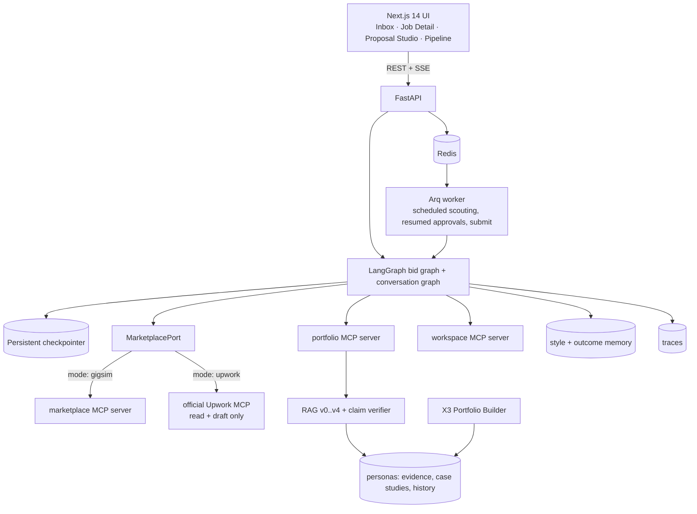
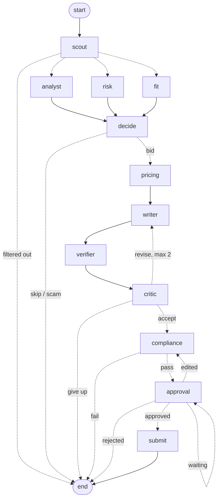

# GigBid architecture

Design rule: **the agent graph never touches a marketplace, file or database directly.** It sees one `MarketplacePort` and a set of MCP tools. Switching from GigSim to live Upwork is a config change (`marketplace.mode`), not a code change.

## 1. System view

## 2. The bid graph (state machine)

Generated from LangGraph (`docs/bid_graph.mmd`). Dashed edges are conditional.

Key properties:
* **Parallel fan-out.** `scout` dispatches `analyst`, `risk` and `fit` with `Send()`; `decide` is the join. They are independent reads of the same job, so latency is the slowest branch, not the sum.
* **Bounded loops.** `critic -> writer` runs at most twice; after that the best draft proceeds to compliance with the critic's unresolved notes attached for the human.
* **Human gate.** `approval` is a LangGraph `interrupt`. The checkpoint is persisted, so a restart resumes at the same node. An edit sends the draft back through `compliance` (the second, post-edit check) before it can reach `submit`.
* **Exactly-once submit.** `submit` calls `submit_proposal` with an idempotency key derived from the job and the approved draft hash, plus a status guard in the marketplace server. A crash after approval and a replay produce one submission (viva scenario 2).

## 3. Why each agent exists

| Node | Why it is separate | What breaks if merged |
|---|---|---|
| `scout` | Cheap filter and fan-out; spends no LLM tokens on obvious non-fits | every job pays full analysis cost |
| `analyst` | Extracts requirements, screening questions, budget, hidden constraints from the job text | writer re-derives them inconsistently |
| `risk` | Scam, unpaid-work, off-platform contact and injection detection, isolated from the writing context | an injected instruction reaches the component that writes and submits |
| `fit` | Matches job needs to verified evidence and skills via RAG; produces the evidence set | bid/skip decisions made on vibes |
| `decide` | Deterministic join: bid, skip, or escalate, using Connects budget and client history | silent over-spending of Connects |
| `pricing` | Fair price band and rate strategy from contract data and persona rate | writer anchors on its own number |
| `writer` | Drafts only from the evidence set and style memory | n/a |
| `verifier` | Claim-by-claim check of every factual statement against evidence (RAG verify) | unsupported claims reach the human |
| `critic` | Qualitative review: generic opening, tone, screening answers; bounded loop | verifier and critic goals conflict inside one prompt |
| `compliance` | Platform rules: no off-platform contact, no guarantees, Connects limits, scam text | one unreviewed edit can violate Terms |
| `approval` | The human decision; the only path to `submit` | automation of what must never be automated |
| `submit` | Single side-effecting node, idempotent | scattered writes |

Single-agent versus graph is compared in `evals/results/agent_comparison.md` (README table, report section 5).

## 4. Conversation graph
Handles client replies after a proposal: classify intent (question, interview request, negotiation, rejection), draft a reply grounded in the same evidence, propose calendar slots through the workspace MCP (`create_tentative_interview_hold` only creates a tentative hold), and stop at the same approval gate before anything is sent.

## 5. Stores and promotion rules

> Check the constants against `agent/memory/` before you present this: they document the intended rule set, and the viva asks for "the promotion rule that let it in".

| Store | Holds | Written by | Promotion rule (candidate to durable) |
|---|---|---|---|
| Evidence (`portfolio_evidence.json`, case studies) | verified facts about the freelancer | the user, ingestion, X3 builder | verified before entry; X3 entries carry `generated_by` and a commit hash |
| Style memory | phrasing, tone, structure the user prefers | diff between the draft and the approved text | a pattern is promoted only after it appears in at least 3 approved edits across at least 2 jobs, is not a factual claim, and contains no client-specific names; user can delete any item in the UI |
| Outcome memory | proposal features vs outcomes (won / replied / ignored) | conversation graph, history import | needs a minimum sample per feature, and is used as a weak prior in `v4_outcome`, never as evidence of a claim |
| Checkpoints | graph state per thread | LangGraph | deleted after a terminal state plus retention window |
| Audit log | every MCP write, hash-chained, append-only | MCP servers | never edited |

Facts are never promoted from memory: style memory may change how something is said, only the evidence store may change what is claimed.

## 6. Failure and degraded behaviour
* Marketplace MCP down: the port raises a typed `MarketplaceUnavailable` after bounded retries (3 attempts, exponential backoff with jitter from 0.5 s, 10 s timeout, per `config.yaml`); the UI shows a banner and pauses scouting, drafts remain editable.
* Live mode reads are throttled (`read_min_interval_seconds: 30`) and the live allow-list has no `submit_proposal`, so submission always happens on the platform after human confirmation.
* The retriever falls back to a lexical variant if the dense index is unavailable (`docs/RUNBOOK.md`).
