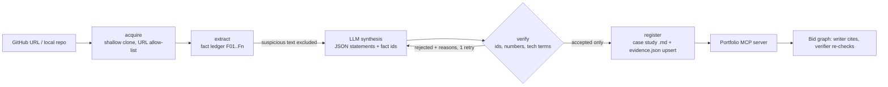

# Signature extension X3: Portfolio Builder

GigBid's proposals are only as good as the evidence behind them. X3 turns a GitHub repository into a **verified case study** and registers it as evidence for the Portfolio MCP server, so the writer agent can cite it and the claim verifier can check it.

> One-line pitch: point it at a repo, get a case study in which every sentence is traceable to a commit, a file, a manifest or a README paragraph, and anything the model made up is deleted before it is saved.

## 1. Usage

```bash
# Preview (writes nothing)
python -m agent.extensions.portfolio_builder --repo https://github.com/<owner>/<repo> --persona ai_ml_engineer --dry-run

# Register (needs ANTHROPIC_API_KEY; GIGBID_BUILDER_MODEL overrides the model)
python -m agent.extensions.portfolio_builder --repo https://github.com/<owner>/<repo> --persona ai_ml_engineer

# Local repo, no LLM, no network: restates code-derived facts only
python scripts/portfolio_builder.py --repo ~/code/my-project --persona fullstack_dev --offline
```

| Flag | Meaning |
|---|---|
| `--repo` | `https://github.com/owner/repo` (shallow-cloned to a temp dir, deleted afterwards) or a local path (read-only) |
| `--persona` | folder under `--data-dir` (default `data/personas`) |
| `--offline` | deterministic fallback, also the evaluation baseline |
| `--dry-run` | print the case study and verification report; write nothing |
| `--force` | rewrite even if the repo's HEAD commit is unchanged |
| `--report PATH` | save the verification report JSON |

Outputs, per persona:

* `data/personas/<persona>/case_studies/CS-GH-NNN.md`: front matter (`id`, `title`, `date` = last commit date, `source`, `commit`, `skills`), Challenge / Architecture / Outcomes, and an Evidence table.
* `data/personas/<persona>/portfolio_evidence.json`: one upserted item per repository, keyed on `source` (`github:owner/repo`). Existing items are never touched.

After registering, re-index so the retriever sees the new evidence (incremental re-index, as for any corpus change), then the Portfolio MCP `search_evidence` / `get_case_study` tools serve it with no code change.

## 2. Architecture



### Fact ledger
Every fact has an id, a kind, a reference and a verification class:

| Kind | Source | Class |
|---|---|---|
| `language` | LOC per language over tracked files | code-derived |
| `dependency` | `requirements*.txt`, `pyproject.toml`, `package.json`, Dockerfile | code-derived |
| `tests`, `ci` | test-file patterns, `.github/workflows` | code-derived |
| `commit_stats` | commit count, first/last date, span in days, author count | code-derived |
| `tag` | release tags with dates | code-derived |
| `source` | first 40 lines of up to N key files (entry points, shallow, larger, not tests) | code-derived |
| `readme` | up to 12 README paragraphs | **self-reported** |
| `commit_subject` | last 8 commit subjects | **self-reported** |

The distinction matters: a README can say "improved accuracy by 40%". The builder can report that the README says so, but it cannot confirm it. Statements that cite only self-reported facts are labelled `self-reported in repo` in the Evidence table, and the Proposal Studio hover should show that label.

### Verification rules (all deterministic, no LLM judge)
A statement survives only if:
1. it cites at least one fact id, and every id exists and was not excluded;
2. every number in the statement appears in the cited facts (commas normalised); the model may not compute or round;
3. every technology term it names is either in the cited facts or was detected in code or manifests (README mentions alone do not count);
4. for `skills`, the skill is detected in code or manifests.

Rejections are fed back once ("you said X, rejected because Y"), then the survivors are kept. If no outcome survives, the case study says so; it never pads.

### Injection and abuse handling
* README text is data: it sits inside `<ledger>` tags with an instruction to ignore directives inside it.
* Facts matching injection patterns ("ignore previous instructions", "system override", ...) are **excluded from the prompt** and listed in the report; rule 1 also rejects any statement citing them.
* Only plain `https://github.com/owner/repo` URLs are cloned (`--` before the URL, `GIT_TERMINAL_PROMPT=0`, no `ext::` or ssh), preventing git argument and transport injection.
* Private repos and tokens are out of scope here: use the read-only GitHub MCP server (see TOOLS.md) to fetch a checkout, then pass the local path.

## 3. What it deliberately does not do
* It does not run the project's code, so "reduced latency by X" can only appear if a README or file states it, and then it is labelled self-reported.
* It does not infer seniority, client names or revenue.
* It does not edit `profile.json`; `list_skills` stays the user's own verified list. Promote skills manually after reading the report.

## 4. Tests
`tests/unit/test_portfolio_builder.py` (13 tests, no network, fake LLM) cover: fact extraction on a real temporary git repo; injected README text never reaching the prompt; rejection of fabricated percentages, technologies, uncited and bad-id statements; retry feedback; unparseable model output; create / update / unchanged idempotency keyed on HEAD; dry run writes nothing; both evidence file layouts; and URL allow-listing.

## 5. Evaluation

Run: `python -m evals.runners.builder_eval --repos evals/datasets/builder_repos.txt` (one URL or path per line; use 8 to 10 public repos of different sizes, including at least two with sparse READMEs and one you wrote with a deliberately hostile README).

| Metric | Definition | Source of truth |
|---|---|---|
| Grounding rate | accepted / (accepted + rejected) statements from the real LLM, first attempt | `evals/results/builder_eval.json` |
| Fabrication catch | share of 4 seeded fake statements (fake %, fake tech, no citation, bad id) that the verifier rejects; control, expected 1.0 | same |
| Human precision | hand-label 30 accepted statements as true / false / unverifiable against the repo | `evals/results/builder_labels.csv` |
| Downstream effect | unsupported-claims-per-proposal and reply-rate proxy with vs without the new evidence on the dev set | `evals/results/rag_benchmark.md` plus a rerun |

Report results in the R&D report section 7 with the commit hash. The deterministic verifier only catches fabrication that contradicts the ledger; it cannot catch a true-but-misleading framing, which is why human precision is measured separately. A negative result (for example, the offline baseline matching the LLM on grounding rate while being less readable) is a legitimate finding.

## 6. Limits
Shallow clones hold at most 300 commits, so commit counts for long histories are lower bounds. LOC counts use tracked files only. The technology vocabulary (`TECH` in the module) is finite; add entries for your stack.
